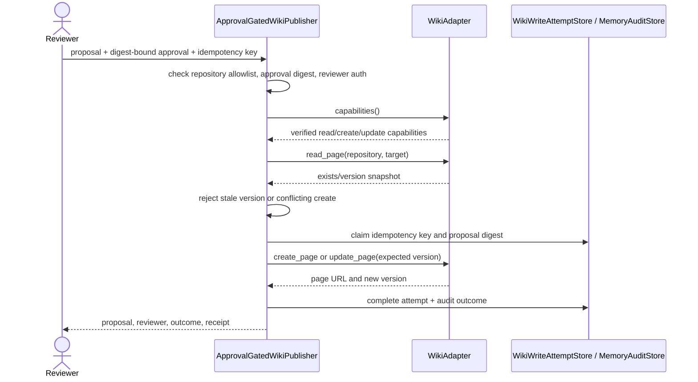

# Project Execution Flow

This guide describes the current code paths, their inputs and outputs, and which paths are ready to run. The **status command** is the only end-to-end CLI workflow. Documentation drafting, persistence, wiki publishing, and evaluations are separate APIs or commands; they are not all invoked by the status command.

## 1. Start the Agent

Both supported launch paths call `agentic_ai.app.main()`:

```powershell
.\.venv\Scripts\python.exe -m agentic_ai status owner/repository
```

or:

```powershell
.\.venv\Scripts\python.exe main.py status owner/repository
```

The CLI argument is the repository name in `owner/repository` form. `Settings` reads `.env` and the process environment. For `status`, configure:

| Setting                       |               Required | Purpose                                                                             |
| ----------------------------- | ---------------------: | ----------------------------------------------------------------------------------- |
| `GOOGLE_API_KEY`              |                    Yes | Google AI Studio API key                                                            |
| `GITHUB_MCP_URL`              | Yes at connection time | GitHub MCP Streamable HTTP endpoint                                                 |
| `GITHUB_MCP_TOKEN`            | Yes at connection time | Bearer token/PAT used for MCP authentication                                        |
| `GITHUB_ALLOWED_REPOSITORIES` |                    Yes | Repository allowlist, such as `["owner/repository"]`                                |
| `GOOGLE_MODEL`                |                     No | Defaults to `gemini-3.8-flash`                                                      |
| `GITHUB_WEB_URL`              |                     No | Defaults to `https://github.com`; used when an issue response omits its browser URL |

The `status` CLI currently uses the workflow's default limit of 30 open issues and 30 open pull requests. `DATABASE_URL` is not required by this CLI path.

## 2. Status Summary: End to End

```mermaid
sequenceDiagram
    actor User
    participant CLI as app.main
    participant Settings
    participant Graph as RepositoryStatusWorkflow (LangGraph)
    participant GitHub as GitHubMCPClient
    participant MCP as GitHub MCP Server
    participant Repo as GitHub API
    participant Gemini as GoogleModelClient

    User->>CLI: status owner/repository
    CLI->>Settings: Settings() reads .env/environment
    CLI->>CLI: configure_logging(settings)
    CLI->>GitHub: GitHubMCPClient(settings)
    CLI->>Gemini: GoogleModelClient(settings)
    CLI->>Graph: RepositoryStatusWorkflow(github, model)
    CLI->>Graph: asyncio.run(workflow.run(repository))
    Graph->>Graph: validate item_limit (default 30)
    Graph->>GitHub: StateGraph.ainvoke(repository, limit)
    Graph->>GitHub: retrieve_open_status node
    par Fetch repository and open issues
        GitHub->>GitHub: get_repository(repository)
        GitHub->>MCP: search_repositories (read-only)
        MCP->>Repo: search repository metadata
        Repo-->>MCP: repository metadata and browser URL
        MCP-->>GitHub: structured/text response
        GitHub->>GitHub: list_issues(repository, state=open, limit=30)
        GitHub->>MCP: list_issues (read-only, cursor pagination)
        MCP->>Repo: list open issues
        Repo-->>MCP: issues and page cursors
        MCP-->>GitHub: issue pages
    and Fetch open pull requests
        GitHub->>GitHub: list_pull_requests(repository, state=open, limit=30)
        GitHub->>MCP: list_pull_requests (read-only, page pagination)
        MCP->>Repo: list open pull requests
        Repo-->>MCP: pull request pages
        MCP-->>GitHub: pull request data
    end
    GitHub-->>Graph: validated Pydantic repository/issues/PRs
    Graph->>Graph: build JSON evidence and SourceReference list
    Graph->>Gemini: analyze(evidence, sources)
    Gemini->>Gemini: request schema-constrained response; store=false
    Gemini-->>Graph: summary, findings, source IDs
    Graph->>Graph: resolve source IDs and validate citations
    Graph-->>CLI: AnalysisResult
    CLI-->>User: formatted JSON on stdout
```

### Status node details

1. `app.main()` parses the command, loads `Settings`, configures logging, and constructs the GitHub and Google clients.
2. `RepositoryStatusWorkflow.run()` invokes its compiled LangGraph `StateGraph` with `repository` and `limit`.
3. The `retrieve_open_status` node calls `GitHubMCPClient.get_repository()`, `list_issues(state="open")`, and `list_pull_requests(state="open")` concurrently. Each repository is checked against the allowlist, each required tool must advertise `read_only_hint=True`, and GitHub pagination is handled by the client.
4. The node serializes the retrieved records as evidence and creates source references for the repository, each issue, and each PR.
5. The `analyze_status` node calls `GoogleModelClient.analyze()`. Retrieved text is treated as untrusted; Gemini returns structured JSON with a source ID for the summary and every finding. The client rejects unknown source IDs and constructs the final `AnalysisResult` using only the original GitHub source objects.
6. The CLI prints `AnalysisResult.model_dump_json(indent=2)`. If GitHub retrieval or model analysis fails, the CLI prints an error to stderr and exits nonzero; it does not print a successful partial result.

### Status input and output

Input:

```text
status octo/project
```

Output is JSON shaped like:

```json
{
  "summary": "One open issue and one open pull request concern search performance.",
  "findings": [
    "Issue 42 reports slow search.",
    "PR 17 proposes indexed search."
  ],
  "sources": [
    {
      "kind": "repository",
      "identifier": "octo/project",
      "title": "octo/project",
      "url": "https://github.com/octo/project"
    },
    {
      "kind": "issue",
      "identifier": "42",
      "title": "Search is slow",
      "url": "https://github.com/octo/project/issues/42"
    },
    {
      "kind": "pull_request",
      "identifier": "17",
      "title": "Use indexed search",
      "url": "https://github.com/octo/project/pull/17"
    }
  ],
  "summary_sources": [
    {
      "kind": "issue",
      "identifier": "42",
      "title": "Search is slow",
      "url": "https://github.com/octo/project/issues/42"
    },
    {
      "kind": "pull_request",
      "identifier": "17",
      "title": "Use indexed search",
      "url": "https://github.com/octo/project/pull/17"
    }
  ],
  "finding_sources": [
    [
      {
        "kind": "issue",
        "identifier": "42",
        "title": "Search is slow",
        "url": "https://github.com/octo/project/issues/42"
      }
    ],
    [
      {
        "kind": "pull_request",
        "identifier": "17",
        "title": "Use indexed search",
        "url": "https://github.com/octo/project/pull/17"
      }
    ]
  ],
  "created_at": "2026-10-07T12:00:00Z"
}
```

`sources` contains all retrieved source objects; `summary_sources` and each `finding_sources` entry show which sources support each claim.

## 3. Documentation Drafting

`DocumentationDraftWorkflow` is callable from Python, but does not yet have a CLI command and does not automatically fetch sprint or release scope. The caller supplies the repository, target page, evidence, source objects, operation (`create` or `update`), and an explicit scope description for sprint status or release notes.

```mermaid
sequenceDiagram
    actor Caller
    participant Draft as DocumentationDraftWorkflow (LangGraph)
    participant Gemini as GoogleModelClient
    participant Models as Pydantic validation

    Caller->>Draft: run(type, operation, repository, target, evidence, sources, scope)
    Draft->>Models: validate DocumentationDraftRequest
    Draft->>Gemini: generate_document(type, evidence, source IDs, scope)
    Gemini->>Gemini: treat GitHub evidence as untrusted; emit structured Markdown/source IDs
    Gemini-->>Draft: GeneratedDocumentContent
    Draft->>Models: validate output and resolve IDs against supplied sources
    Draft->>Draft: append escaped links from trusted SourceReference URLs
    Draft-->>Caller: ProposedWikiChange preview
```

The result is a `ProposedWikiChange` with repository, target page, operation, Markdown content, and source references. **It is only a draft; this graph does not publish it.**

Example programmatic input:

```python
proposal = await DocumentationDraftWorkflow(model_client).run(
  document_type="sprint_status",
  operation="update",
  repository="octo/project",
  target_page="Sprint-12",
  scope_description="Sprint 12, 2026-09-01 through 2026-09-14",
  evidence=serialized_retrieved_github_evidence,
  sources=source_references,
)
```

The returned `ProposedWikiChange` contains `operation`, `repository`, `target_page`, `content` with generated Markdown and verified source links, and the matching `sources` list.

## 4. Wiki Publishing Boundary

`ApprovalGatedWikiPublisher.publish()` is a separate programmatic API. It requires a `WikiApproval` bound to the SHA-256 digest of the exact proposal, reviewer authorization, verified adapter capabilities, and an unchanged page version for updates. A persistent idempotency claim is recorded before calling the adapter. Uncertain write results are marked and blocked from automatic retry.



The default `UnavailableWikiAdapter` reports no verified capability, so publishing fails closed. The official GitHub MCP integration currently configured by this project exposes no documented Wiki tools; no writer is enabled.

## 5. Persistence and Evaluations

Persistence is not called by the status CLI. `MemoryAuditStore` uses async SQLAlchemy sessions and Alembic-managed tables for approved scoped memories, structured audit events, and wiki write attempts. Configure `DATABASE_URL` and apply migrations with `alembic upgrade head` before using those APIs.

The offline evaluation command is independent of model/GitHub credentials:

```powershell
.\.venv\Scripts\python.exe -m agentic_ai.evaluations
```

It loads `tests/fixtures/grounded_analysis_v1.json`, reports citation coverage and alignment, source precision, required-term coverage, tool selection, read-only compliance, and injection-sentinel leakage, then exits nonzero if a threshold fails. Current thresholds are provisional; see [OPERATIONS.md](OPERATIONS.md) for setup and recovery notes.
